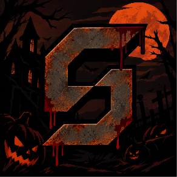

# StelleraFlix

**A cross-platform streaming platform - Web, Desktop, Mobile, and Fire TV.**

---

## What we're building

StelleraFlix is a streaming platform built for every screen. We're developing a unified experience across web browsers, native desktop, mobile, and Fire TV - backed by a modular server infrastructure handling authentication, media discovery, playback sync, and personalisation.

## Platforms

| Platform | Description |
|---|---|
| 🌐 Web | Browser-based streaming |
| 🖥️ Desktop | Native Windows and macOS app |
| 📱 Mobile | iOS and Android app |
| 📺 Fire TV | Amazon Fire TV lean-back experience |

## Stack

---

© StelleraFlix
